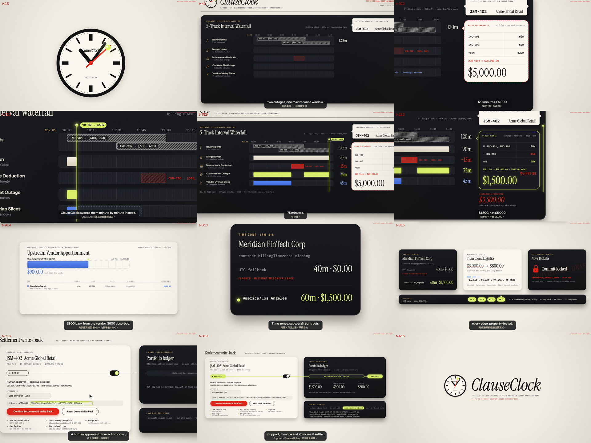
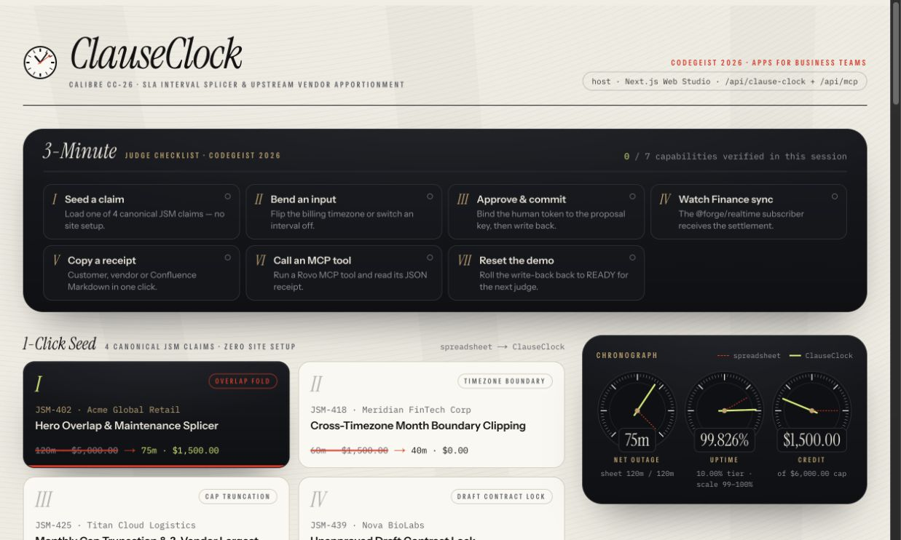
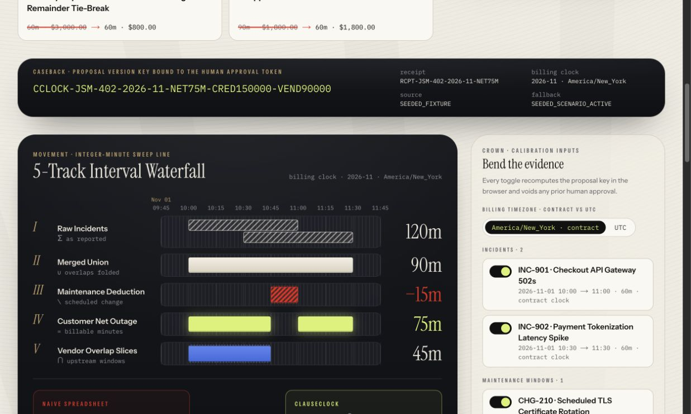
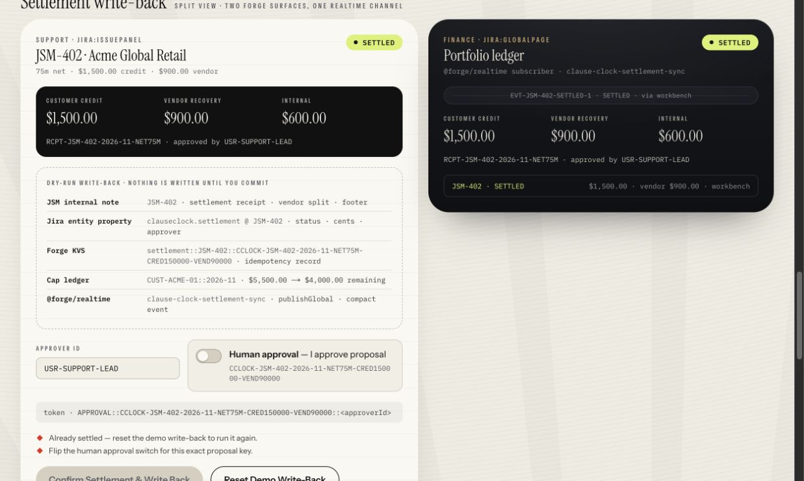
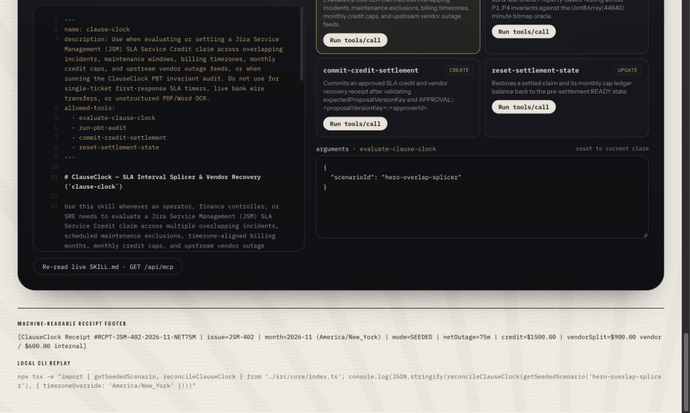

# ClauseClock — JSM SLA Service Credit Interval Splicer & Upstream Vendor Apportionment Workbench

> **Atlassian Codegeist 2026 Submission** · Category: **Apps for Business Teams**  
> **Bonus Prizes Targeted**: **Best apps with Teamwork Graph integration** · **Best Agents — Rovo/Assignable agents** · **Best app with Atlassian MCP**

**ClauseClock** (`Calibre CC-26`) is a dual-target Atlassian Forge application (`jira:issuePanel`, `jira:globalPage`, `rovo:agent`, `rovo:skill`, `rovo:mcp`, `action`, `Teamwork Graph` read integration, and `@forge/realtime` live broadcast) paired with a shared-core standalone Next.js Web Studio.

When an enterprise customer submits a Jira Service Management (JSM) SLA Service Credit claim after a month of overlapping incidents and scheduled maintenance windows, spreadsheets over-count downtime and over-issue thousands of dollars in credits. **ClauseClock** replaces spreadsheet guesswork with a **pure-TypeScript integer-minute sweep-line engine**, **exact `BigInt` Largest-Remainder upstream vendor penalty apportionment**, **3-role `fast-check` Property-Based Testing (`P1..P4`) against an independent `Uint8Array(44640)` minute-bitmap oracle**, and a **version-bound human approval gate**.

---

## Visual Gallery

### Launch Film (`The Calibre Escape` — 45s 1080p30)
- **YouTube Demo Video**: [https://youtu.be/xFWynDts-Ow](https://youtu.be/xFWynDts-Ow)
- **Live Interactive Web Studio**: [https://atlassian-clause-clock.vercel.app](https://atlassian-clause-clock.vercel.app)
- **Full 45-second narrated launch film (in-repo MP4)**: [`docs/media/clause-clock-demo.mp4`](/docs/media/clause-clock-demo.mp4)
- **12-Beat Contact Sheet**: [`docs/media/stills.png`](/docs/media/stills.png)



### 1. The Calibre CC-26 Workbench & 3-Minute Codegeist Judge Rail (`/`)
A zero-setup 7-step Judge Guided Checklist Bar, 1-Click Seed 4-Scenario switcher, and Swiss chronograph subdials comparing Naive Spreadsheet figures against `ClauseClock` net billable downtime, uptime, and credit liability.



### 2. The 5-Track Interval Waterfall & Calibration Inputs
Folds two overlapping 60-minute P1 incidents (`INC-901` + `INC-902` = `120m` raw) into a `90m` union, subtracts a `15m` scheduled change window (`CHG-210`) down to **`75m` net billable downtime** (`99.8266%` uptime → `$1,500.00` net credit instead of `$5,000.00`, **preventing a `$3,500.00` spreadsheet overcharge**), and apportions `45m` (`60%` = **`$900.00`**) to upstream vendor `CloudEdge Transit` and `30m` (`40%` = **`$600.00`**) to internal absorption.



### 3. Split-View `@forge/realtime` Settlement Write-Back (`Support · jira:issuePanel` ↔ `Finance · jira:globalPage`)
Committing a settlement with a version-bound approval token atomically saves the customer/month ledger and a pending-delivery record in Forge Custom Entity Storage through `@forge/kvs`. The handler then writes the Jira Entity Property and JSM internal note and calls `@forge/realtime` `publishGlobal`; a failed delivery is reported as `PENDING_RETRY` and resumes on the next action. Jira writes and realtime are separate services, not one atomic transaction. Reset restores the ledger and property status; historical JSM notes remain as an audit trail. The standalone Web Studio uses an in-memory demonstration store and local subscribers.



### 4. Embedded Rovo MCP & Open-Source `SKILL.md` Live Inspector
Inspects the live [`skills/clause-clock/SKILL.md`](/skills/clause-clock/SKILL.md) contract and executes all 4 deterministic MCP tools (`evaluate-clause-clock`, `run-pbt-audit`, `commit-credit-settlement`, `reset-settlement-state`) against the shared store with full JSON request/response receipts and machine-readable footers.



---

## Why ClauseClock? (The Problem & Architecture)

1. **Native JSM SLA Timers Only Track Single Tickets**: JSM measures first-response and resolution targets per ticket, but enterprise B2B SLA contracts calculate **monthly cumulative uptime** across multiple overlapping incidents minus scheduled maintenance windows, clipped to the contract's billing timezone and monthly credit cap.
2. **Upstream Vendor Recovery Is Disconnected from Customer Credits**: When an outage is partially caused by an upstream cloud or transit provider, Support and Finance teams have no deterministic way in Jira/JSM to slice `NetOutage ∩ VendorOutageWindows` and apportion integer cents without rounding drift.
3. **Zero AI Math Hallucinations**: Rovo Agents and MCP clients never compute dollar figures in token space. All monetary amounts are locked to structured contract JSON; any AI-supplied fee or credit override is rejected and logged in `discardedAiAmountOverrides`.

---

## Four Canonical Seeded Scenarios (1-Click Evaluation)

| # | Scenario ID & Claim | What It Demonstrates | Naive Spreadsheet | ClauseClock Result |
|---|---|---|---|---|
| **I** | `hero-overlap-splicer` (`JSM-402` · Acme Global Retail) | Two 60m incidents overlap by 30m (`90m` union) minus `15m` maintenance (`CHG-210`) = `75m` net outage (`99.8266%` uptime, `10%` tier `$2,000` gross minus `$500` prior approved). Apportions `45m` (`60%`) to `CloudEdge Transit`. | `120m` (`25%` tier = **`$5,000.00`**) | **`75m` · `$1,500.00`** (`$900.00` vendor / `$600.00` internal · **`$3,500.00` saved**) |
| **II** | `cross-timezone-boundary` (`JSM-418` · Meridian FinTech Corp) | Contract omits `billingTimezone` (`missingTimezoneFallback: true`, defaults to `UTC`), clipping 20 post-month minutes from `2026-11-30T23:20Z`–`2026-12-01T00:20Z` (`40m` = compliant `0%` tier). Flipping the inline timezone switcher shifts the boundary (`60m` = `10%` tier) and voids stale approvals. | `60m` (**`$1,500.00`**) | **`40m` · `$0.00`** in `UTC` (`60m` · `$1,500.00` under timezone shift) |
| **III** | `monthly-cap-truncation` (`JSM-425` · Titan Cloud Logistics) | `$3,000.00` gross credit truncated by remaining monthly cap (`$4,000` cap minus `$3,200` prior = **`$800.00`**); 3 upstream vendors with equal `20m` overlaps split `80,000` cents via `BigInt` Largest Remainder into **`26,667 + 26,667 + 26,666 === 80,000` cents**. | `60m` (**`$3,000.00`**) | **`60m` · `$800.00`** (`$266.67` / `$266.67` / `$266.66` across 3 vendors) |
| **IV** | `unapproved-contract-draft` (`JSM-439` · Nova BioLabs) | Contract in `DRAFT` status (`provisionalDraftMode: true`) computes full preview receipts while locking `commit-credit-settlement` (`400 UNAPPROVED_CONTRACT_DRAFT`) until a Finance Override reason is supplied. | `90m` (**`$1,800.00`**) | **`60m` · `$1,800.00` Preview** (Commit locked until Finance Override) |

---

## 3-Role Conditional Property-Based Testing (`P1..P4`)

Backed by [`fast-check`](https://github.com/dubzzz/fast-check) and an algorithmically independent **`Uint8Array(44640)` minute-by-minute discrete bitmap oracle** ([`src/core/clause-clock-pbt.ts`](/src/core/clause-clock-pbt.ts)):

- **`P1` (Interval Algebra Equivalence, Commutativity, Idempotence & Split-Invariance)**: Sweep-line `netOutageMinutes`, `mergedIncidentMinutes`, `maintenanceDeductedMinutes`, `vendorCoveredMinutes`, and per-vendor `overlapMinutes` match the `Uint8Array(44640)` bitmap oracle identically (`===`) and remain invariant under permutation, duplication, and contiguous interval splitting.
- **`P2` (Monotonicity, Contract Fee Lock & Monthly Cap Bound)**: Adding an incident never decreases `netOutageMinutes` or `newCreditCents`; `0 <= newCreditCents <= Math.max(0, monthlyCapCents - priorApprovedCents)` holds universally; AI overrides are discarded into `discardedAiAmountOverrides`.
- **`P3` (Vendor Apportionment Cent Conservation)**: Exact `BigInt` Largest Remainder Method guarantees integer cents and `sum(vendorApportionments.map(v => v.apportionedCents)) + internalAbsorbedCents === newCreditCents` with zero cent drift.
- **`P4` (Idempotent Commit & Reset Round-Trip)**: Committing with `APPROVAL::${proposalVersionKey}::${approverId}` transitions the claim to `SETTLED`, updates the monthly cap ledger once, and replays idempotently (`idempotentReplay: true`) on duplicate calls; `reset-settlement-state` restores the exact pre-commit `READY` state and cap balance.

---

## Quick Start & Verification

### 1. Install Dependencies
```bash
npm install
```

### 2. Run the Automated Acceptance & PBT Tests + Typecheck
```bash
npm test
npm run typecheck
```

### 3. Build & Start the Interactive Web Studio
```bash
npm run build
npm run dev
```
Open `http://localhost:3000` to explore the **ClauseClock** 5-Track Workbench, 3-Minute Judge Checklist Bar, Split-View `@forge/realtime` preview, and Rovo MCP & `SKILL.md` Live Inspector.

### Build and deploy the Forge app

```bash
npm run build:forge-ui
npm run verify:forge
npx forge register ClauseClock --personal
npx forge deploy -e production
npx forge install -e production -p Jira -s YOUR-SITE.atlassian.net
```

`forge register` replaces the explicitly unregistered placeholder app ID in the manifest. Registration, deployment, consent and the installation link require the owner's Atlassian account and have not been run in this checkout. The local verifier uses the official CLI's manifest validator and runtime packager without uploading the app. The CLI's `forge lint` command requires login.

Custom UI reuses the Web Studio workbench. Its bridge invokes the same four actions through `src/index.ts`; its KVS ledger survives cold invocations. For live data, the handler reads the current Jira issue, the `clauseclock.scenario` entity property (validated structured scenario JSON), and related work items using `api.asUser().requestTeamworkGraph`. Jira REST calls use `asApp()`. Missing issues, missing properties or unavailable Graph access produce a labeled seeded receipt. Seeded accounts never write to real Jira issues. [Live scenario contract and deployment details](/docs/FORGE_DEPLOYMENT.md).

The billing window is the interval between local midnight on the first of this month and local midnight on the first of the next month, converted to UTC. Interval minutes are elapsed time from the contract timezone's month start. This includes DST: November 2026 in New York and Los Angeles contains 43,260 minutes. Scenario II keeps the demonstrated `$0 → $1,500` by placing the outage at the end of November in UTC.

---

## Repository Structure

```text
manifest.yml                              Atlassian Forge manifest (jira:issuePanel, jira:globalPage, rovo:agent, rovo:skill, rovo:mcp, 4 actions, single function router)
skills/clause-clock/SKILL.md              Open-source Agent Skill contract (name: clause-clock, 4 deterministic allowed-tools)
src/core/clause-clock-types.ts            Shared TypeScript domain contracts, CalculationReceipt & SourceProvenanceManifest
src/core/clause-clock-scenarios.ts        4 canonical seeded JSM SLA & vendor outage scenarios
src/core/clause-clock-engine.ts           Pure integer-minute sweep-line, BigInt Largest-Remainder cent engine & Uint8Array(44640) bitmap oracle
src/core/clause-clock-pbt.ts              3-Role fast-check PBT auditor (P1..P3, reachability witnesses, mutation calibration & counterexample replay)
src/actions/clause-clock-store.ts         In-memory demonstration store shared by the Web Studio routes
src/forge/forge-runtime.ts                Persistent Forge action adapter, revision checks and pending delivery
src/forge/forge-sdk.ts                    Official KVS, Jira/JSM, Teamwork Graph and realtime API calls
src/index.ts                             Forge action and Custom UI resolver entry point
forge-ui/                                Forge bridge host adapter mounting the shared workbench
scripts/build-forge-ui.mjs                Static Custom UI and self-contained Forge runtime bundle
src/actions/clause-clock-dispatcher.ts    Unified 4-action dispatcher, human approval token & TOCTOU gate, Teamwork Graph & Jira REST query builders, P4 verifier
src/actions/forge-contract-validator.ts   Static contract validator across manifest.yml, skills/clause-clock/SKILL.md & TypeScript action schemas
app/_studio/                              Host-agnostic React workbench driven by ClauseClockHostPort (shared by Web Studio & Forge Custom UI)
app/api/clause-clock/route.ts             REST endpoint for the 4 ClauseClock actions
app/api/mcp/route.ts                      JSON-RPC initialize/notifications, tools and resources; legacy inspector format
tests/                                    Automated tests for the core, protocol, Forge adapter and shared workbench
```

---

## License

Released under the [MIT License](/LICENSE).
