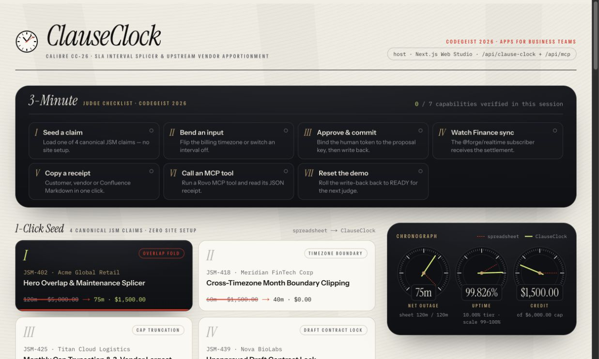
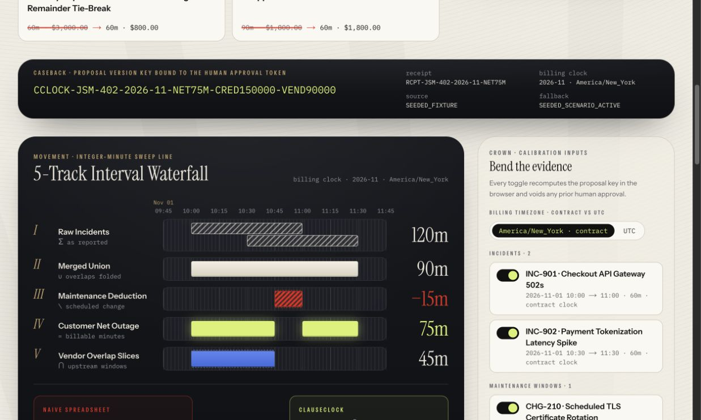
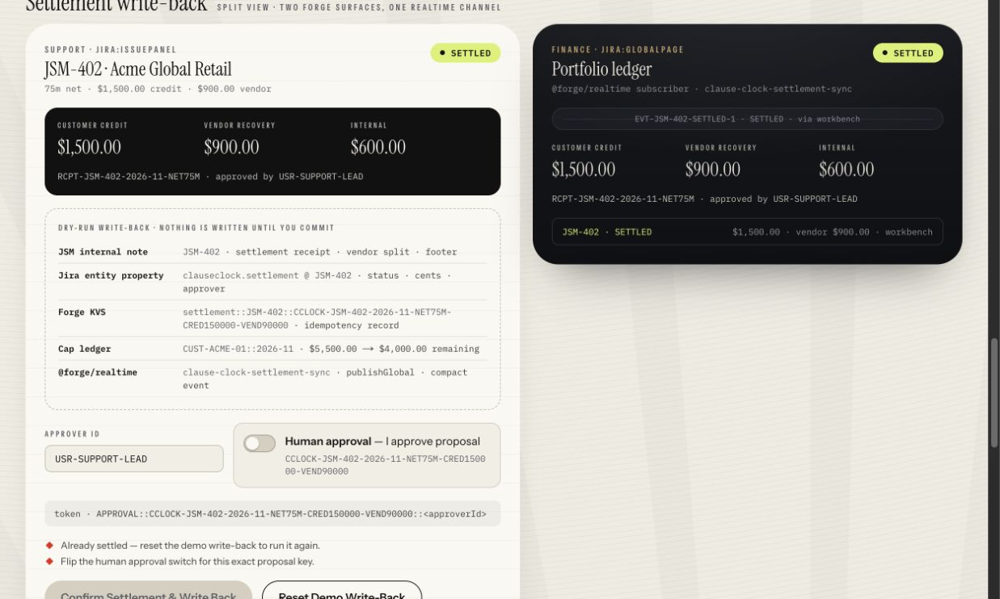
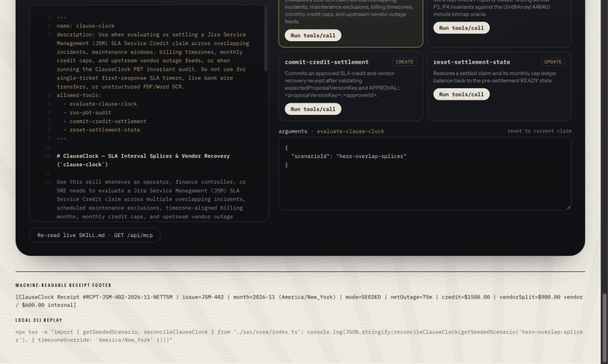
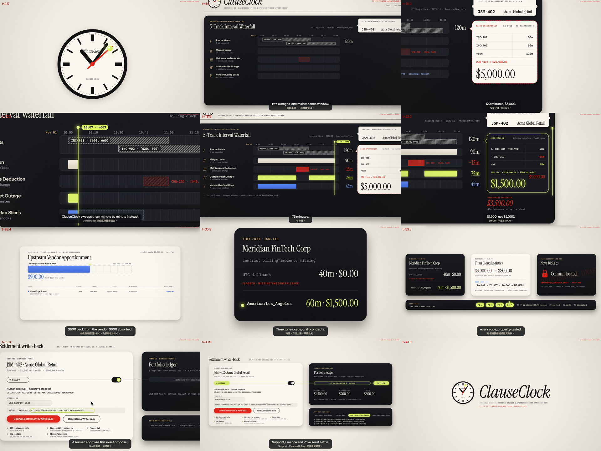

# ClauseClock — SLA credits without spreadsheet double-counting

When incidents overlap, adding ticket durations overstates the outage. ClauseClock merges those intervals, subtracts scheduled maintenance, clips the result to the contract’s billing month and timezone, and calculates the customer credit and vendor recovery in integer cents.

[Try the standalone Web Studio](https://atlassian-clause-clock.vercel.app) · [Watch The Calibre Escape](https://youtu.be/xFWynDts-Ow) · [Read the source](https://github.com/GGGODLIN/atlassian-clause-clock)

## Forge Installation Link

- **Install on Jira / JSM Cloud (`Runs on Atlassian` · Production v2.0.0)**: [Install ClauseClock via Atlassian Developer Console](https://developer.atlassian.com/console/install/cd62612f-32bd-404d-bc40-be4be9903daa?signature=AYABeLFzohpUoHzQsRpiMOomlVQAAAADAAdhd3Mta21zAEthcm46YXdzOmttczp1cy13ZXN0LTI6NzA5NTg3ODM1MjQzOmtleS83MDVlZDY3MC1mNTdjLTQxYjUtOWY5Yi1lM2YyZGNjMTQ2ZTcAuAECAQB4CxqLTo9l4lqXuFjNim1xJM%2Bp%2F3TVP9xHS2BrU5DRRucBFcbo4nuzl%2FazDifKS6brfAAAAH4wfAYJKoZIhvcNAQcGoG8wbQIBADBoBgkqhkiG9w0BBwEwHgYJYIZIAWUDBAEuMBEEDIsPp%2BOQYFtjKblYbwIBEIA7V31nCOXTISZID51ZVseyVslfJoH4v9a4a%2BvVR0id%2F86wUyVyvgRj9FgeMP9nTQ%2B7q5s%2Bzjw4swkUIkcAB2F3cy1rbXMAS2Fybjphd3M6a21zOmV1LXdlc3QtMTo3MDk1ODc4MzUyNDM6a2V5LzQ2MzBjZTZiLTAwYzMtNGRlMi04NzdiLTYyN2UyMDYwZTVjYwC4AQICAHi9bVMAkme4qVQX1fQHo6ePw3H40A7cGfz7yrmSfBWMXgHwvr1bzQ3rupGNOxqrK8ApAAAAfjB8BgkqhkiG9w0BBwagbzBtAgEAMGgGCSqGSIb3DQEHATAeBglghkgBZQMEAS4wEQQMFAprjIEGm2S9DtMXAgEQgDv9wnghdUZQvhdizzJYSkogVRhZUHP9LN%2FVnhS7QwnuEQHhcQg%2F7PY%2F%2BUrKH6OMO9fw443XzFXRrormBgAHYXdzLWttcwBLYXJuOmF3czprbXM6dXMtZWFzdC0xOjcwOTU4NzgzNTI0MzprZXkvNmMxMjBiYTAtNGNkNS00OTg1LWI4MmUtNDBhMDQ5NTJjYzU3ALgBAgIAeDYASx0XCjkny4iLV6vz%2BKtEGSGT6kdt0QRpkn6D%2FlVEAV741%2Bne5gxvqpkyohOBLsMAAAB%2BMHwGCSqGSIb3DQEHBqBvMG0CAQAwaAYJKoZIhvcNAQcBMB4GCWCGSAFlAwQBLjARBAy1Qyz0WXfFXDrBxR0CARCAOy7BJtrXsVKQqALSAP0ni5bx8mj30uToBULqCuOEIMIU0Y0fhW1Ie2Aw2Hm4nf%2BkjWQ2dAcHahPsUvijAgAAAAAMAAAQAAAAAAAAAAAAAAAAAA03xyeMKi1ZBH3n5KJIA1X%2F%2F%2F%2F%2FAAAAAQAAAAAAAAAAAAAAAQAAADI8kPQapj300YjV5xMtsRK4yyccx7SoCCOIn7466sYOS81gbszD9Tii5qVPhkI4y4m7asJoxceu70NMCte%2BU2oThRA%3D&product=jira)
- **Registered Forge App ID**: `ari:cloud:ecosystem::app/cd62612f-32bd-404d-bc40-be4be9903daa`

## What it does

In the hero example, two overlapping incidents report 120 minutes. Their union is 90 minutes; subtracting 15 minutes of maintenance leaves 75 minutes. The locked contract produces a $1,500 credit instead of the spreadsheet’s $5,000. Vendor recovery receives $900 and internal absorption receives $600. November’s New York billing window includes the DST transition, so the calculated uptime is 99.8266%.

| Scenario | Demonstration |
| --- | --- |
| Overlapping incidents | 120 raw minutes → 75 billable minutes; $5,000 spreadsheet credit → $1,500 |
| Billing timezone | An outage from November 30 23:20 UTC to December 1 00:20 UTC is 40 November minutes in UTC ($0), but 60 November minutes in Los Angeles ($1,500) |
| Monthly cap | A $3,000 gross credit is capped to $800; three vendors receive 26,667 + 26,667 + 26,666 cents |
| Draft contract | Preview remains available; settlement requires an explicit Finance override reason |

## How we built it

A shared TypeScript engine drives Next.js and Forge Custom UI. The Forge handler uses `@forge/api` for Jira and Teamwork Graph, `@forge/kvs` for a persistent customer/month ledger, `@forge/realtime` for refresh hints, and `@forge/bridge` for frontend invocation. It reads related work from Teamwork Graph as the current user and structured scenario data from a Jira entity property. If the test site has no matching issue or cannot supply the live data, the receipt explicitly says seeded and gives the fallback reason.

The ledger transaction is conditional on its revision. Jira notes, entity properties and realtime delivery follow the ledger save; failures report pending delivery and can be retried. The standalone Web Studio uses in-memory demo state. Approval tokens bind proposals but are not authentication credentials. Real site behavior, Graph access and installation remain deployment acceptance items.

The [PBT auditor](https://github.com/GGGODLIN/atlassian-clause-clock/blob/main/src/core/clause-clock-pbt.ts) checks interval algebra against an independent minute bitmap, monetary cap bounds and cent conservation. Additional tests compare physical UTC minutes with `Intl` calendar membership across timezones and exercise persistent-store reload, concurrent settlement and delivery retry. The [portable skill](https://github.com/GGGODLIN/atlassian-clause-clock/blob/main/skills/clause-clock/SKILL.md) calls the deterministic tools instead of asking an LLM to calculate money.

The public MCP endpoint accepts JSON-RPC initialization, initialized notifications, tool discovery/calls and resource discovery/reads. Its legacy inspector request format remains supported.

## Try it in three minutes

This is a walkthrough target, not a measured installation-time guarantee.

1. Follow the actual Forge Installation Link above and install on a Jira test site.
2. Open the ClauseClock global page. Select the hero scenario and verify 75 minutes and $1,500 credit.
3. Select the timezone scenario. Toggle UTC to Los Angeles and compare $0 with $1,500.
4. Enter an approver, approve the displayed proposal and commit. Reload to verify persistence, then watch the Finance view refresh.
5. Run the PBT tool in the inspector, inspect its receipt, and reset the demo.

For live data preparation, internal-note checks and production commands, use the [Forge deployment guide](https://github.com/GGGODLIN/atlassian-clause-clock/blob/main/docs/FORGE_DEPLOYMENT.md).

[Download the demo film](https://github.com/GGGODLIN/atlassian-clause-clock/blob/main/docs/media/clause-clock-demo.mp4) · [MIT License](https://github.com/GGGODLIN/atlassian-clause-clock/blob/main/LICENSE)
